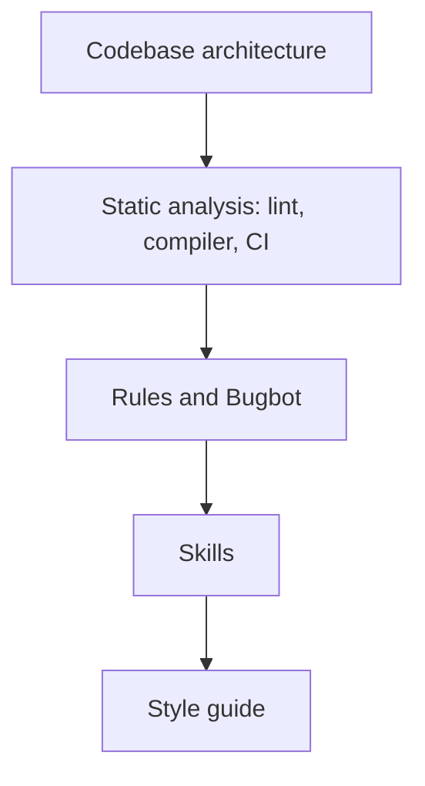

<blockquote class="twitter-tweet" data-dnt="true" data-theme="dark" data-testid="talk-embed">
  <p>Lauren Tan (poteto) on making coding agents trustworthy (video, about 56 minutes).</p>
  <a href="https://x.com/0xjmori/status/2111469450104860684">Watch the talk on X</a>
</blockquote>
<script async src="https://platform.twitter.com/widgets.js" charset="utf-8"></script>

*Talk by [Lauren Tan (poteto)](https://x.com/poteto), shared in [this post on X](https://x.com/0xjmori/status/2111469450104860684). It runs about 56 minutes.*

> A small note before we start. The tweet that shared this video frames it with a lot of hype. The talk itself is calmer than that. It's mostly about the unglamorous work that makes agents reliable: verification, evals, architecture, and CI checks.

I watched this talk once and came away with only a vague idea of what it was about. So I went back through it properly, and this post is me writing down what I understood, in enough detail that I (and maybe you) can actually use it.

Lauren Tan, who goes by poteto online, is an engineer at Cursor. At the time of the talk she'd been there for about five months and had landed more than 3,000 PRs in that period using agents. She also wrote [pstack](https://github.com/cursor/plugins/tree/main/pstack), a Cursor plugin full of skills and commands. The name is a spoof of Garry Tan's gstack.

## TL;DR

- Running more agents doesn't make you more productive if you can't trust what they produce. Without verification, you end up micromanaging a handful of them.
- Teach agents to check their own work. Give them verification skills and a feature map of your app so they can drive the UI instead of guessing.
- Treat skills like code. Write evals for them, run them on agents that don't know they're being tested, and grade with a different model.
- Watch what agents actually do ("backseat driving") and turn every failure into a skill or a check.
- Shape the codebase so the easy local change is also the correct change. Then enforce the important rules mechanically in CI, not just in prose.
- Keep PRs small and atomic. Spending tokens upfront on architecture and evals pays off.

## The trust problem

The first idea in the talk is a trust curve. It's tempting to think that if one agent makes you faster, ten agents make you ten times faster. Lauren's point is that trust doesn't scale with the number of agents.

If you can't trust an agent's output, you have to check everything yourself. Then you are the bottleneck. You end up babysitting somewhere between one and five agents, reading every diff, re-running every flow, correcting small mistakes.

The same problem shows up at the other end. You could spin up thousands of cloud agents, but without verification loops they mostly burn tokens. Nobody knows which of their outputs are good.

So the real question isn't "how many agents can I run?" It's "how do I make an agent's work trustworthy without me checking all of it by hand?" The rest of the talk is a set of answers to that.

## Verification skills: let the agent check its own work

A skill, in Cursor terms, is a set of instructions (a markdown file plus any scripts) that an agent can pick up when it needs to do a specific job.

A verification skill teaches the agent how to confirm that its change actually works. Instead of writing code and saying "this should fix it", the agent opens the app and checks. Lauren mentioned things like opening Chrome DevTools, reading performance traces, using iOS simulators, and driving the UI directly.

The difference is between an agent that guesses and an agent that observes. For a bug like "clicking Save does nothing", a guessing agent reads the code, finds something plausible, changes it, and stops. A verifying agent changes the code, starts the app, clicks Save, and checks that the saved state actually appears.

pstack has two commands for this:

- `/create-verification-skill` builds a verification skill for your project.
- `/maintain-verification-skill` keeps it up to date as the project changes.

### Feature maps

For an agent to drive your UI, it needs to know what the UI looks like and how to find things in it. That's what a feature map is for.

A feature map is plain markdown, for example `features/README.md`, that documents the app's layout, its sub-features, the DOM attributes you can use to target elements, and keyboard shortcuts. Here's a small made-up example of what one entry could look like for a blog site:

```md
## Blog post page (/blog/<slug>/)

Layout: header, table of contents (left), article body, audio player (top of article).

Sub-features:
- Audio player: play/pause, speed. Root: [data-component="audio-player"]
- Table of contents: links to each h2/h3. Root: [data-testid="toc"]
- Theme toggle: button with aria-label="Toggle theme"

Shortcuts:
- "/" focuses search

Ready state:
- The page is ready when [data-test-status="settled"] is present on <body>.
```

With this file, the agent doesn't have to explore the whole app every time. It reads the map, knows where things are, and goes straight to verifying.

### Driving conventions

The talk also covered how agents should target elements. The rule is to prefer stable, meaningful attributes over class names:

- ARIA labels, like `aria-label="Toggle theme"`
- `data-component`, `data-action-id`, `data-testid`

Here's why. Compare these two selectors:

```js
// Fragile: breaks when someone changes styling or the CSS framework renames classes
document.querySelector('.flex.items-center.gap-2 > button.btn-primary');

// Stable: survives styling changes because it describes what the element is
document.querySelector('[data-testid="save-post"]');
```

Class names exist for styling. They change whenever the design changes. A `data-testid` exists for exactly one reason, which is to be found. So an agent using it won't break every time someone tweaks the CSS.

The second convention is to wait on state a user would actually observe, not on arbitrary timeouts. Lauren's example was an attribute like `data-test-status: settled`. The agent waits until that attribute shows up rather than sleeping for two seconds and hoping.

The third is to use `eval()` to read DOM state directly. Instead of taking a screenshot and interpreting pixels, the agent evaluates a bit of JavaScript in the page and gets an exact answer:

```js
// Is the post saved? Ask the DOM instead of guessing from a screenshot.
document.querySelector('[data-testid="save-status"]')?.textContent;
// "Saved"
```

## Evals: unit tests for your skills

Once you start writing skills, a new question appears. How do you know a skill actually works? A skill is just text. An agent might ignore half of it, or misread it.

Lauren's answer is to write evals for skills, the same way you'd write unit tests for code. The setup she described goes like this:

1. A coordinator agent writes a rubric for what "good" looks like for the skill.
2. It spawns subagents to do a task using the skill. These subagents run in hidden, cleverly named folders so they don't know they're being tested. That matters, because agents behave differently when they know they're in a test.
3. A judge agent grades the results against the rubric. The judge runs on a different model than the agents being tested, to avoid a model grading its own kind of output too kindly.
4. A `/loop` then hill-climbs. It tweaks the skill, reruns the eval, and keeps going until the skill scores 10/10 reliably.

So if a skill keeps scoring 6/10 because agents skip the "wait for settled state" step, the loop keeps adjusting the skill until agents follow that step every time.

## Backseat driving

Lauren talked about "backseat driving" agents. You read their tool calls, the code they write, and their thinking blocks, so you can see exactly where they go wrong.

Each failure becomes something permanent. If an agent keeps forgetting to start the dev server before testing, that becomes a step in a skill. If it keeps making the same kind of mistake in code, that becomes a check. She said this is how pstack itself was built.

She also recommended starting locally. Watch the agent bring up your app on your own machine first, see where it struggles, and fix that. Once it works reliably locally, scale it to cloud agents.

## What this looks like at scale: Benny

One example from inside Cursor is Benny. Benny is an internal cloud agent you talk to in Slack. You give it a vague bug report, and it spins up a cloud desktop, reproduces the bug through UI automation, and opens a PR with a fix.

That only works because of everything above. Reproducing a bug from a vague report means driving the UI, which needs verification skills and feature maps. Opening a fix PR you can trust means the agent confirmed the fix, not just wrote it.

## Agent-friendly architecture

Lauren made an observation about big-tech brownfield codebases, like Meta's monorepo. They're full of guardrails built for the least capable engineer who might touch them. That sounds like a downside, but it makes them surprisingly good for agents. The guardrails stop agents from doing the wrong thing the same way they stop a new hire.

Then the opposite story. An internal agent app at Cursor was vibe-coded, with nobody reading the code. It spiraled. Getting it back under control took more than 600 PRs to refactor it into an agent-friendly architecture she called "Dune".

### How agents actually behave

The Dune doc describes how agents behave:

> A coding agent usually optimizes for what fits in its context: copy the nearest working pattern; edit the file already open; choose the shortest path that compiles; avoid deleting code whose callers are not visible; follow the requested implementation even when it conflicts with a system invariant.

None of these are bad on their own. The problem is that an agent only sees part of the codebase. So it does whatever makes sense locally, even when that's wrong for the system as a whole.

You can't make the agent see everything. So you change the codebase so that the locally obvious move is also the right one. The phrase from the talk is "make the locally obvious change the globally correct change."

### The five rules

Dune has five rules. Here's each one with a plain example of what I think it means.

**1. The conventional path requires fewer decisions than a shortcut.**
If adding a feature the right way means creating one file in a known place, and the hacky way means touching five files, the agent takes the right way because it's easier. Make the correct path the lazy path.

**2. Forbidden dependencies fail mechanically.**
If the UI layer must never import the database client, don't just write that in a doc. Add a check that fails the build when it happens. The agent can't miss a failing build.

**3. Every durable value has one obvious writer.**
If a user's settings can be written from three different places, an agent will copy whichever one it finds first, and you get inconsistent data. If there's exactly one module that writes settings, the agent finds it and uses it.

**4. New product work adds isolated files rather than branches in shared roots.**
Adding a new feature shouldn't mean adding another `if (feature === 'x')` branch to a big shared file. It should mean adding a new folder. That way, new work can't quietly break old work.

**5. Exceptions are narrow, explicit, and reviewed as architecture changes.**
Sometimes you do need to break a rule. That's fine, but the exception should be small, clearly marked, and reviewed as a change to the architecture, not slipped into a feature PR.

In Dune, features are owned folders. Each feature folder has its Entrypoints and Transcript cards, and the app discovers them from reserved files. So adding a feature means adding a folder with the right files, which is rule 4 in practice.

## Layers of defence, and why hard rules win

The talk described a stack of layers that keep agents on track. From the most fundamental to the least:



Her earlier [tweet with an inverse pyramid](https://x.com/poteto/status/2111133080526495985) puts it in a similar order. Fix the codebase first, then add static checks, then prose rules, and human review comes last.

The key point is that soft rules alone aren't enough. If your only guardrail is a rules file that says "please don't do X", the codebase rots over time, because agents won't follow prose rules every time. You need hard rules that fail the build.

She also noted that strict compilers help a lot here, Rust and strong type systems for example. CI that humans find annoying is fine for agents. They just absorb it and fix the errors.

### Hard rules in CI

She gave some concrete examples of hard rules her team enforces in CI:

**Banning `useEffect`.** CI fails if the React `useEffect` hook shows up in the code.

**Banning code comments.** The reason was that agents kept leaving historical comments in the code, things like "Lauren said never do this". Those comments are about the conversation that produced the code, not about the code itself, and they pile up. So comments are banned mechanically.

**An import-boundary checker.** The app is an Electron app, which has a main process and a renderer process. Heavy main-process imports were ending up in the renderer, which blew the 16ms frame budget you need for 60fps. So a checker now keeps `electron-main` and `electron-renderer` code separate, and CI fails if something crosses the line.

To make the third one concrete, a check like that can be as simple as this sketch (my illustration, not their actual code):

```ts
// Fail CI if any renderer file imports from the main process.
import { readFileSync } from 'node:fs';
import { globSync } from 'glob';

const offenders = globSync('src/electron-renderer/**/*.{ts,tsx}').filter((file) =>
  /from ['"].*electron-main/.test(readFileSync(file, 'utf8')),
);

if (offenders.length > 0) {
  console.error('Renderer must not import electron-main:', offenders);
  process.exit(1);
}
```

Bugbot (Cursor's automated PR reviewer) also runs in CI as another layer.

## Small, atomic PRs

Her PRs were typically 50 to 1,000 lines, often with a lot of deletions. But the general preference was small and atomic.

There are two reasons. A small PR is easier to revert if something goes wrong. And git history becomes context for future agents. When an agent later looks at why some code exists, a clean history of small, focused commits tells it much more than one giant "refactor everything" commit.

## Cost

On cost, she framed it as an ROI tradeoff. Spending tokens upfront on architecture and evals pays off later, because agents waste far less effort once the codebase and skills are in good shape.

She also said a smart, cheap model with tight constraints beats the biggest model. If the codebase, checks, and skills keep the agent on the right path, you don't need the most expensive model to get good results.

## Who uses this app

The internal app she was describing is an iMessage-like interface where even non-engineers orchestrate agents. One example was PMs asking agents to summarize what other agents did overnight, and then approving PRs based on that. That only makes sense if the verification and guardrails underneath are solid enough to trust.

## How I can use this

Here's how I plan to apply this, starting with my own projects.

### My portfolio (this site)

I'm adding a project-local verification skill to this site. It's in [PR #20](https://github.com/g-savitha/gsavitha.in/pull/20), which may not be merged by the time you read this. The idea is:

- A `bun run verify:site` command that builds the site and checks it, so an agent (or I) can confirm a change actually works.
- A feature map in `.cursor/skills/verify-gsavitha-in/` that describes the site's pages and how to find things on them, like the feature map example above.

If I want to build or refresh that skill using pstack, `/create-verification-skill` and `/maintain-verification-skill` are the commands for it. pstack also has `/poteto-mode`, which makes the agent work in poteto's style: concise answers, deliberate subagents, simple code, and verified work.

My Cursor rules in [g-savitha/ai-stuff](https://github.com/g-savitha/ai-stuff) cover the same ideas:

- `rules/cursor/agent-trust-pyramid.mdc` follows the inverse pyramid. Fix the code first, then checks, then prose rules, then review.
- `rules/cursor/verification-first.mdc` asks the agent to verify its work before saying it's done.

Rules are the soft layer, though. The talk is clear that they work best on top of hard checks, not instead of them.

### Side projects, like my URL shortener

My FastAPI URL shortener is a good place to try the smaller ideas:

- **A verify script.** It would curl the create endpoint, follow the redirect, check that expired links stop working, and check the `X-Cache` header to confirm caching behaves as expected. An agent can run this after every change instead of telling me "it should work".
- **pytest as the hard layer.** Tests fail mechanically, which is exactly the kind of check that doesn't depend on an agent reading instructions.
- **Small, atomic PRs.** One change per PR, so it's easy to revert and the history stays readable for future agents.
- **`data-testid` in the playground UI.** The shortener has a small playground page. Adding `data-testid` attributes there means an agent can drive it reliably without depending on class names.

### Cursor at work

At work, I still review every PR myself. None of this changes that. What these ideas do is add checks before a PR reaches me, so the agent has already verified its change, the tests pass, and the obvious mistakes are caught by CI. My review stays. It just starts from a better place.

## Closing thoughts

What I took away is that trusting agents is mostly an engineering problem, not a prompting problem. You make the codebase easy to change correctly, you turn important rules into checks that fail, you teach agents to verify their own work, and you test the skills you give them. Each of those is ordinary engineering work, and together they're what let you hand more work to agents without checking all of it by hand.

If you have an hour, I'd recommend watching the talk at the top of this post.
