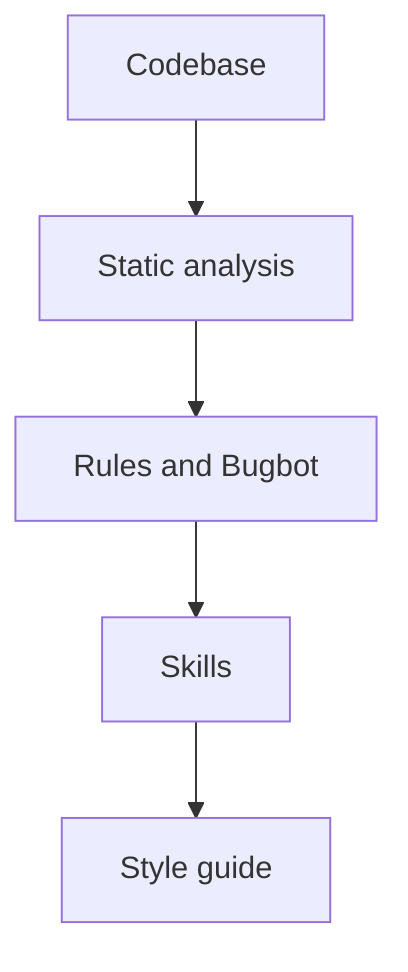

<Embed url="https://x.com/0xjmori/status/2111469450104860684" title="Lauren Tan (poteto) on making coding agents trustworthy (video, about 56 minutes)" />

*This is a talk by Lauren Tan, who goes by poteto online. She first gave it on August 12, 2026, as a free Maven Lightning Lesson called "How Cursor Turned AI Agents Into Better Engineers". Colin Matthews hosted it. The video above is a repost of that recording on X, and it runs about 56 minutes. A longer copy (59:41) is on YouTube. Links to all of these are in the Sources list at the end.*

> A small note before we start. The X repost frames the talk with a lot of hype. Its caption has lines like "85% of engineers are already running teams of 10+ agents" and "my bots are shipping code while I sleep". Those lines aren't in the talk. The talk itself is calmer. It's mostly about the unglamorous work that makes agents reliable: verification, evals, architecture, and CI checks.

I watched this talk once and came away with only a vague idea of what it was about. So I went back through it properly. This post is me writing down what I understood, in enough detail that I (and maybe you) can actually use it.

## Who Lauren is

At the time of the talk, Lauren had been at Cursor for about five months. Before that, she was on the React team at Meta, working on the React Compiler. Before Meta, she was at Netflix. There she was a tech lead and then an engineering manager for about two years.

That management background comes up again and again in the talk. She keeps comparing working with agents to managing a team.

Her slide says she shipped more than 3,000 PRs in those five months. She said about 1,000 of them landed in the month before the talk. By August 12 she was already close to 800 for that month.

She also wrote pstack, a Cursor plugin full of skills. The name is a joke on gstack, a plugin by Garry Tan, the CEO of Y Combinator. The P stands for poteto. They share a last name, but they aren't related.

## TL;DR

- You can only run as many agents as you trust. If you can't trust one agent's output, you end up micromanaging a handful of them.
- Teach agents to check their own work. Give them a verification skill and a feature map of your app, so they can drive the UI instead of guessing.
- Treat skills like code. Write evals for them, run them on agents that don't know they're being tested, and grade with a different model.
- Watch what agents actually do ("backseat driving"). Turn every repeated failure into a skill or a check.
- Shape the codebase so the easy local change is also the correct change. Then enforce the important rules in CI, not only in prose.
- Keep PRs small and atomic. Spending tokens upfront on architecture and evals is an ROI call, and she thinks it pays off.

## The trust curve

The talk starts with a hand-drawn chart. Trust is on one axis. The number of agents you run is on the other, going from 1, to 1–5, to 5–10, to 10–20, then hundreds, then thousands.

Lauren compares this to managing people. If a manager doesn't trust their team, they micromanage. They look over everyone's shoulder and check every piece of work.

Agents work the same way. When you don't trust them, you're deep in the loop with one or a handful of agents. You watch every output and keep prompting. You can't run 100 agents when you don't trust the output of one.

As her trust went up, she could run more. She's now at the point where her agents auto-merge PRs for her. On the morning of the talk, about 20 PRs had already landed. She reviewed them on main, after they merged, and said they were good.

She was clear that there's no shortcut along this curve. If you're still at the "one to five agents" stage, don't jump to thousands of cloud agents. You'll mostly burn a lot of tokens, and it will be very expensive.

## Three ways to trust agents more

One slide sums up the plan for the rest of the talk. To trust your agents more, you need:

1. Verification.
2. High-quality skills that teach agents to work like real software engineers. pstack is her example.
3. Refactoring or rewriting your architecture so it's agent-friendly.

The rest of this post follows that order.

## Verification: let the agent check its own work

For Lauren, verification is the most important skill an agent can have. It means the agent can actually run the code and test it, the same way your users would see it.

Depending on the app, that could mean driving the UI, taking CPU traces or heap snapshots, or opening an iOS simulator. For web and Electron apps, the agent can use the Chrome DevTools Protocol (CDP), which lets code control a browser the way DevTools does.

She was careful about what this gets you. Verification doesn't guarantee that the agent writes *good* code. It does help the agent write *correct* code, which is a big step toward trust.

Here's the difference in practice. Say the bug is "clicking Save does nothing". A guessing agent reads the code, finds something plausible, changes it, and stops. A verifying agent changes the code, starts the app, clicks Save, and checks that the saved state actually appears.

### Where it started: control-glass

The first skill Lauren built at Cursor was called control-glass. Glass is the internal code name for Cursor's agents window, which is a React app.

In her first week, she was doing performance work on it with a tight deadline. She'd open Chrome DevTools, take a trace, and try to read the flame graph herself. Then she'd send screenshots and trace files to her agent.

The agent didn't know the codebase either. It would confidently name a cause, she'd fix that, and it would turn out to be wrong.

Without a verification skill, *you* are the verifier. You test the change, copy back screenshots and console errors, and wait. You're the bottleneck, so you can't run agents in parallel.

control-glass taught the agent to run the agents window and take traces itself. She said the code of a skill like this isn't very interesting, and your agent can write one for you.

### Feature maps

Once the agent could run the app, a new problem showed up. It didn't know what anything in the app was.

Someone would say "the left sidebar is laggy", and the agent would flail. It spent a lot of time searching the code. It was trying to work out where that feature lived and how to reach it in the UI.

The fix was a feature map. It's a folder of markdown files with a `README.md` at the top. There's one file per feature (like `sidebar.md` or `settings.md`), plus one for flows that cross several features.

Each file describes a feature from the user's point of view. It says what the feature is, how to get to it, its sub-features, keyboard shortcuts, and the attributes you use to select its elements. The README on screen says the files "teach how to use a feature, not how it is built".

This is what makes vague reports useful. Cursor has a Slack channel for feedback on the agents window. Lauren said reports there are often just a screenshot and "???". With a feature map, an agent can work out where that screenshot is and how to get there.

Here's a small made-up example of one entry, for a blog site:

```md
## Blog post page (/blog/<slug>/)

Layout: header, table of contents (left), article body, audio player (top of article).

Sub-features:
- Audio player: play/pause, speed. Root: [data-component="audio-player"]
- Table of contents: links to each h2/h3. Root: [data-component="toc"]
- Theme toggle: button with aria-label="Toggle theme"

Shortcuts:
- "/" focuses search

Ready state:
- The article is ready when the audio player's play button is enabled.
```

With a file like this, the agent doesn't have to explore the whole app every time. It reads the map, finds the feature, and goes straight to checking it.

### Driving conventions

The feature map she showed also has rules for how the agent should drive the app. A few stood out to me.

**Prefer ARIA labels and meaningful data attributes.** The list on screen was ARIA labels, `data-component`, `data-action-id`, `data-message-*`, and `data-tool-*`. Class selectors are a fallback. Only a few components have `data-testid`, and the agent uses those only when the feature file names them.

Here's why that matters. Compare these two selectors:

```js
// Fragile: breaks when someone changes styling or the CSS framework renames classes
document.querySelector('.flex.items-center.gap-2 > button.btn-primary');

// Stable: survives styling changes because it describes what the element does
document.querySelector('[data-action-id="save-post"]');
```

Class names are there for styling, so they change whenever the design changes. An attribute that names what the element *is* or *does* stays put.

**Wait for something a user would see.** Agent output streams in, so timing isn't predictable. The rule is to poll for visible end states, like a status label or a button becoming enabled. A short "settle" wait only covers quick UI transitions. It doesn't wait for an agent turn or a tool call to finish.

**Read the DOM directly.** The agent uses `eval` to read DOM state, the clipboard, and attributes. It gets an exact answer from the page:

```js
// Is the post saved? Ask the DOM for the status label.
document.querySelector('[data-component="save-status"]')?.textContent;
// "Saved"
```

Two more rules on screen: prefer the registered keyboard shortcut over clicking at screen coordinates. And watch the console while testing any flow that should finish with no console errors.

pstack has two skills for all this:

- `/create-verification-skill` explores your code and builds a verification skill for your project, including a first feature map.
- `/maintain-verification-skill` keeps it up to date as the project changes.

## Skills, and how pstack grew

A skill, in Cursor terms, is a set of instructions that an agent can pick up when it needs to do a specific job. It's mostly a markdown file, sometimes with scripts.

Lauren uses the new-hire comparison here. Think of an agent as a strong engineer you hired five seconds ago. They can code well, but they have no business context. A skill is how you teach that person to be effective.

She never set out to build pstack. It grew one skill at a time. After control-glass, she noticed agents confidently naming the cause of a bug without reading the code that was actually involved. She could see it in their tool calls. That became another skill, which tells the agent to stop guessing, look up the code, and use subagents.

She also said not to trust her blindly. Look at pstack, fork it, and make the skills your own. Every team has its own engineering standards, and the point is to encode yours.

## Evals: unit tests for your skills

Once you start writing skills, a new question appears. How do you know a skill actually works? A skill is just text. An agent might ignore half of it, or misread it.

Lauren's answer is evals. Her mental model is that an eval is a unit test for an agent. You don't need a special framework. pstack ships an eval playbook inside its poteto-mode skill. The setup goes like this:

1. A coordinator agent writes a rubric for what "good" looks like for the skill.
2. It spawns subagents to do a task with the skill. Each one runs in its own folder, with a name chosen so it doesn't realize it's being tested. Agents can tell when they're being evaluated, and they behave differently when they do.
3. A judge agent on a different model grades the results. That cross-check helps catch bias in the model doing the grading.
4. You hill-climb. In Cursor you can use `/loop` and tell it to keep running the eval until everything scores 10 out of 10.

Because Cursor supports many models, you can also run the same eval across several of them. That shows how the skill holds up on the models you actually use.

She runs an eval like this every time she changes a skill. She built control-glass the same way, and said it took a lot of iteration before it got good.

Say a skill keeps scoring 6/10 because agents skip the "wait for the visible end state" step. The loop keeps adjusting the skill until agents follow that step every time.

## Backseat driving

Lauren was honest that maintaining skills is hard. She said it takes a lot of taste and observation.

Her advice is to be a backseat driver. Think of pair programming, when you watch a coworker and ask "why didn't you do it this way?". Don't just watch the agent passively. Open its tool calls, read the code it writes, and read its thinking blocks. That's where you see where it fails.

Each failure can then become something permanent. If an agent keeps forgetting to start the dev server before testing, that becomes a step in a skill. If it keeps making the same kind of mistake in code, that becomes a check.

She compared the new job to being a head chef. You don't cook every dish yourself anymore. You have line cooks and a sous chef. Your job is to design the kitchen and hand out the tasks.

## Start local, then go to the cloud

Colin asked where to start if you want to build a verification setup. Her answer was local.

On your own machine, you can watch the agent bring up your app. You can see how it interacts with it and where it struggles. Once that works, you can move to cloud agents.

She's now mostly on cloud agents. Her point was that a good verification skill helps more than one engineer. Cloud agents and automations can reuse it, so it helps the whole team, and even the whole company.

### Benny

Her example is an agent at Cursor called Benny. Benny picks up the bug reports that come in. For each one, it starts its own cloud desktop, runs Cursor there, and uses the same control skills to try to reproduce the bug.

In the example she showed, Benny reproduced the bug and found it was already fixed on main. So the only thing left was to ship a new build. She didn't have to spend an hour with an agent working out whether it was fixed.

## Rewrite or not?

The third part of the talk is about refactoring, and even rewriting. Engineers are usually told not to rewrite. Lauren made a case that it depends.

Her observation is that a lot of big-tech problems are now everybody's problems. At Meta, tens of thousands of engineers commit to one giant monorepo. She said the code quality there is often not great. Her joke was "before AI slop, we had human slop".

So big-tech infra is built for the least capable engineer who might touch it. There are frameworks, conventions, and guardrails. Credentials are locked down so an intern can't wipe the production database. If your codebase already has that, agents can do solid work in it. The guardrails stop them the same way they stop a new hire.

Greenfield apps (brand-new projects) are, in her view, both the biggest risk and the biggest opportunity.

Her example was Grok Bot, the agent app Cursor had just launched. It started as a fast, vibe-coded prototype. Humans weren't reading the code. With no guardrails, agents solved every task in whatever way was most convenient, and the codebase spiraled.

Her fix was strong constraints. She spent more than 600 PRs refactoring Grok Bot into a new architecture. She now says she doesn't really look at its code anymore. She also said that took a lot of work and a lot of tokens.

The CI is strict, and writing code in that codebase is "very annoying". Agents absorb that annoyance, though. And the payoff is that designers, PMs, and even GTM (go-to-market) people can add features without her worrying about a performance regression landing overnight.

## Dune: agent-friendly architecture

Dune is the cheeky code name for Grok Bot's architecture. Lauren described it as something like Next.js for Electron apps, designed for agents to write. She said it's more a set of ideas and principles than something they'll open source.

### How agents actually behave

The Dune doc she showed starts with a contract that describes how agents behave:

> A coding agent usually optimizes for what fits in its context: copy the nearest working pattern; edit the file already open; choose the shortest path that compiles; avoid deleting code whose callers are not visible; follow the requested implementation even when it conflicts with a system invariant.

None of these are bad on their own. The problem is that an agent only sees part of the codebase. So it does whatever makes sense locally, even when that's wrong for the system as a whole.

You can't make the agent see everything. So you change the codebase so that the locally obvious move is also the right one. The doc puts it as "make the locally obvious change the globally correct change". One of her key principles says the same thing more simply: the shortest path is the best path.

### The five rules

Dune has five rules. Here's each one with a plain example of what I think it means.

**1. The conventional path requires fewer decisions than a shortcut.**
Say the right way to add a feature is one new file in a known place, and the hacky way touches five files. The agent takes the right way because it's easier. Make the correct path the lazy path.

**2. Forbidden dependencies fail mechanically.**
If the UI layer must never import the database client, don't just write that in a doc. Add a check that fails the build when it happens. The agent can't miss a failing build.

**3. Every durable value has one obvious writer.**
If three different places can write a user's settings, an agent will copy whichever one it finds first. Then you get inconsistent data. If there's exactly one module that writes settings, the agent finds it and uses it.

**4. New product work adds isolated files rather than branches in shared roots.**
Adding a new feature shouldn't mean adding another `if (feature === 'x')` branch to a big shared file. It should mean adding a new folder. That way, new work can't quietly break old work.

**5. Exceptions are narrow, explicit, and reviewed as architecture changes.**
Sometimes you do need to break a rule. That's fine, but the exception should be small, clearly marked, and reviewed as a change to the architecture, not slipped into a feature PR.

In Dune, a feature is an owned folder. Its entry points and transcript cards (the cards you see in the chat) live in reserved files in that folder. The app finds them there. So all the code for one feature sits in one place. Lauren said about 80% of the work stays inside that one folder. That's rule 4 in practice.

## Layers of defence, and why hard rules win

The talk lists five layers that keep agents on track, from strongest to weakest:



The codebase is the strongest layer, because agents love to copy existing patterns. Static analysis means lint rules, compiler errors, and CI checks.

The first two are hard. They turn CI red, so the agent can't ship around them. The other three are soft. Rules, skills, and Bugbot (Cursor's automated code reviewer) help, but an agent can forget them or apply them unevenly.

Lauren still layers the soft ones on top. She just doesn't rely on them alone. In her words, if you only have rules, Bugbot, skills, and a style guide, "it's only a matter of time" before the codebase is a mess.

About two months after the talk, she posted an inverse pyramid on X with the same idea for whenever you correct your agent. Codebase is at the top, then static analysis, then prose, and human review comes last.

The worst place to be, she said, is enforcing your codebase's rules through code review comments. Each time you write "don't do this" on a PR, treat it as a code smell. Ask how to turn it into a lint rule or a CI failure, or how to remove that whole class of problem.

This is also why your tech stack matters. She pointed to Rust, where the compiler is very strict. If agents avoid `unsafe` blocks and the code compiles, you can be fairly confident it works. You can rely on the compiler instead of checking everything yourself.

### Hard rules in CI

She gave a few concrete examples of rules that fail CI in Grok Bot.

**No `useEffect`.** It's one of React's biggest footguns, so it's banned, and CI fails if it shows up.

**No code comments.** She said that 99% of the time, agents' comments described some bit of history. It had nothing to do with the code. Things like "Lauren said never do this", when she'd only meant "this one PR needs changing". So comments are banned too.

**Import boundaries.** This one comes from a problem in the agents window, which doesn't use Dune yet. Electron apps have a renderer process that draws the UI and a main process for other work.

In the agents window, heavy code kept ending up on the renderer by accident. At 60 frames per second, each frame has about 16 milliseconds. Heavy computation or I/O there causes jank. Every merged PR could bring that back.

So Grok Bot has separate `electron-main` and `electron-renderer` directories. A CI check walks the import graph and fails if code crosses from one to the other. She plans to bring this approach back to the agents window.

To make that concrete, a check like this could be as simple as the sketch below (my illustration, not their actual code):

```ts
// Fail CI if any renderer file imports from the main process.
import { readFileSync } from 'node:fs';
import { globSync } from 'glob';

const offenders = globSync('src/electron-renderer/**/*.{ts,tsx}').filter((file) =>
  /from ['"].*electron-main/.test(readFileSync(file, 'utf8')),
);

if (offenders.length > 0) {
  console.error('Renderer must not import electron-main:', offenders);
  process.exit(1);
}
```

The same rules show up in Bugbot and in their AGENTS.md too, as extra layers.

## Small, atomic PRs

Her PRs range from about 50 lines to around 1,000, depending on the change. Some are mostly deletions. There's no hard cap, but she asks her agents to split work into several PRs.

She gave two reasons. A small PR is easier to revert when something goes wrong, because the bug isn't buried in a 40,000-line PR. And git history is a rich source of context. When each PR describes one small change, later readers (human or agent) can follow why the code is the way it is.

## Tokens and cost

A common question was whether this is realistic if you don't have unlimited tokens. Lauren was upfront that she works at an AI lab with unlimited tokens, so she can't say everyone should do it exactly her way. She does think you can get there without breaking the bank.

She framed it as ROI. Refactoring a codebase and adding all these checks costs a lot of tokens upfront. Without agents, though, building that framework and doing that refactor alone would have taken her years. For an engineering leader, the tradeoff is hiring someone to do it versus spending the tokens.

Once the codebase is in that shape, she said, even agents that aren't the biggest models do an excellent job. She also mentioned that Cursor and SpaceXAI aim for a good balance of cost and intelligence, rather than the biggest model possible.

She was clear that nothing here is free. But she thinks, if you do your own analysis, the ROI comes out positive.

## Grok Bot and non-engineers

The last question was how product teams keep up when engineers ship this fast. Her answer was Grok Bot.

Cursor's earlier tools (the agents window, the CLI, the IDE) are built for developers. Grok Bot looks like iMessage. You can give each agent a name, and orchestrating them feels like talking to a team.

A PM can have an agent summarize everything Lauren's agents did overnight. PMs also ship code. They send her bug fixes, she reviews them, and often they're already right.

She sees that as proof that Dune is holding up. The strict constraints let people who aren't engineering experts contribute at a high level.

## How I can use this

Here's how I plan to apply this, starting with my own projects.

### My portfolio (this site)

This site now has a project-local verification skill. It went in with PR #20 (linked below). The idea is:

- A `bun run verify:site` command that builds the site and checks it, so an agent (or I) can confirm a change actually works.
- A feature map in `.cursor/skills/verify-gsavitha-in/features/` that describes the site's pages and how to find things on them, like the example above.

If I want to build or refresh that skill with pstack, `/create-verification-skill` and `/maintain-verification-skill` are the commands for it. pstack also has `/poteto-mode`, which makes the agent work in poteto's style: concise answers, deliberate subagents, simple code, and verified work.

My Cursor rules in g-savitha/ai-stuff cover the same ideas:

- `rules/cursor/agent-trust-pyramid.mdc` follows the inverse pyramid. Fix the code first, then checks, then prose rules, then review.
- `rules/cursor/verification-first.mdc` asks the agent to verify its work before saying it's done.

Rules are the soft layer, though. The talk is clear that they work best on top of hard checks, not instead of them.

### Side projects, like my URL shortener

My FastAPI URL shortener is a good place to try the smaller ideas:

- **A verify script.** It would curl the create endpoint, follow the redirect, check that expired links stop working, and check the `X-Cache` header to confirm caching behaves as expected. An agent can run this after every change instead of telling me "it should work".
- **pytest as the hard layer.** Tests fail mechanically, which is exactly the kind of check that doesn't depend on an agent reading instructions.
- **Small, atomic PRs.** One change per PR, so it's easy to revert and the history stays readable for future agents.
- **Stable selectors in the playground UI.** The shortener has a small playground page. Adding ARIA labels and `data-*` attributes there means an agent can drive it reliably without depending on class names.

### Cursor at work

At work, I still review every PR myself. None of this changes that. What these ideas do is add checks before a PR reaches me. By then the agent has verified its change, the tests pass, and CI has caught the obvious mistakes. My review stays. It just starts from a better place.

## What I took away

Trusting agents is mostly an engineering problem, not a prompting problem. You make the codebase easy to change correctly. You turn important rules into checks that fail. You teach agents to verify their own work, and you test the skills you give them.

Each of those is ordinary engineering work. Together, they're what let you hand more work to agents without checking all of it by hand.

If you have an hour, I'd recommend watching the talk.

## Sources

- [How Cursor Turned AI Agents Into Better Engineers](https://maven.com/p/e23d9c/how-cursor-turned-ai-agents-into-better-engineers), Lauren Tan and Colin Matthews, Maven Lightning Lesson, August 12, 2026
- [The talk on YouTube: "Lauren Tan workshop XAi Grokbot"](https://www.youtube.com/watch?v=ONeM6YDmvqA) (59:41)
- [X repost of the talk with video](https://x.com/0xjmori/status/2111469450104860684) (about 56 minutes)
- [Lauren Tan (poteto) on X](https://x.com/poteto)
- [poteto's inverse pyramid post on X](https://x.com/poteto/status/2111133080526495985)
- [pstack on GitHub](https://github.com/cursor/plugins/tree/main/pstack)
- [PR #20: verification skill for this site](https://github.com/g-savitha/gsavitha.in/pull/20)
- [g-savitha/ai-stuff on GitHub](https://github.com/g-savitha/ai-stuff)
