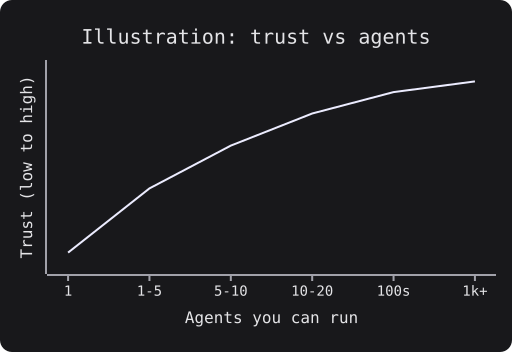

*The ideas in this post come from Lauren Tan's (poteto) talk "How Cursor Turned AI Agents Into Better Engineers". The talk and the video are linked under [Further reading](#further-reading).*

I watched this talk once and only came away with a vague idea of it. So I went back through it properly. Here's what I took from it, one idea at a time, each with a short "how you can do it".

## TL;DR

- You can only run as many agents as you trust.
- Set up verification first. The agent should run the code and check it, the way a user would.
- Give the agent a feature map of your app and stable hooks in your UI.
- Turn repeated failures into skills, and repeated review comments into checks that fail CI.
- Make the easy local change the correct one. Start local, then move to the cloud.

## Trust limits how many agents you can run

It's tempting to think that if one agent makes you faster, ten agents make you ten times faster. That only works if you trust what they produce.

Think about managing a team. If you don't trust your engineers, you check every piece of their work, and the team can't go faster than you can check. Agents work the same way. You can't run a hundred agents when you don't trust the output of one.

The talk draws this as a curve. The more you trust your agents, the more of them you can run in parallel. The chart below is an illustration of that idea, not real data.



There's no shortcut along this curve. If you jump straight to thousands of cloud agents without trust, you mostly burn tokens, because nobody can tell which of their outputs are good.

### How you can do it

- Start with one agent and one kind of task you do often.
- Ask yourself what you still check by hand after the agent says it's done. Each of those checks is something to automate, using the ideas below.
- Add more agents only when you've stopped re-checking the work of the ones you have.

## Verify first

Verification means the agent runs the code and checks the result, the same way your users would see it. Depending on the app, that could mean driving the UI, calling an API, taking a CPU trace or a heap snapshot, or opening an iOS simulator.

For web and Electron apps, the agent can use the Chrome DevTools Protocol (CDP). That's the protocol DevTools itself uses, and it lets code control a browser.

Here's the difference in practice. Say the bug is "clicking Save does nothing". A guessing agent reads the code, finds something plausible, changes it, and stops. A verifying agent changes the code, starts the app, clicks Save, and checks that the saved state actually appears.

In Playwright, that check is a few lines:

```ts
import { test, expect } from '@playwright/test';

test('clicking Save saves the post', async ({ page }) => {
  await page.goto('/posts/new');
  await page.locator('[data-action-id="save-post"]').click();
  await expect(page.getByText('Saved')).toBeVisible();
});
```

Verification doesn't guarantee *good* code, but it helps the agent write *correct* code. Without it, *you* are the verifier, pasting screenshots and console errors back to the agent. You're the bottleneck again.

### How you can do it

- Give the agent one command that builds the project and checks it. On this site, that's `bun run verify:site`, which builds the site and then runs a script that checks it.
- Tell the agent to use it, in your rules or `AGENTS.md`. Ask it to run the command before saying "done", to check UI changes the way a user would, and to show what it ran and what it saw instead of saying "this should work".
- Let your agent write the first verification skill. pstack, a Cursor plugin full of skills, has `/create-verification-skill` to build one and `/maintain-verification-skill` to keep it up to date.

## Give the agent a feature map

Once an agent can run your app, a new problem shows up. It doesn't know what anything in the app is.

Someone reports "the left sidebar is laggy", and the agent flails, searching the code for where the sidebar lives. A screenshot with no words gives it even less to go on.

A feature map fixes that. It's a folder of markdown files that describes each feature from the user's point of view. Each file says what the feature is, how to get to it, its sub-features, its keyboard shortcuts, and the attributes you use to select its elements.

The files teach how to *use* a feature, not how it's built. With a map, the agent goes straight to the feature and checks it, instead of exploring the whole app every time.

### How you can do it

- Make a folder with a `README.md` at the top and one file per feature. Add one more file for flows that cross several features.
- Keep each entry about using the feature. Here's a small made-up example for a blog site:

```md
## Blog post page (/blog/<slug>/)

Sub-features:
- Audio player: play/pause, speed. Root: [data-component="audio-player"]
- Theme toggle: button with aria-label="Toggle theme"

Ready state:
- The article is ready when the audio player's play button is enabled.
```

- Let `/create-verification-skill` in pstack write a first map. This site has one in `.cursor/skills/verify-gsavitha-in/features/`.

## Add UI hooks agents can drive

An agent that drives your UI needs to find elements and know when the page is ready. If it guesses, it breaks every time the design changes. Class names are there for styling, so they change. An attribute that names what the element *does* stays put.

```js
// Fragile: breaks when the styling changes
document.querySelector('.flex.items-center.gap-2 > button.btn-primary');

// Stable: describes what the element does
document.querySelector('[data-action-id="save-post"]');
```

### How you can do it

- Prefer ARIA labels and meaningful data attributes, like `data-component` and `data-action-id`. Use class names only as a fallback.
- Wait for something a user would see. Timing isn't predictable when output streams in, so poll for a visible end state, like a button becoming enabled.
- Read the DOM directly with a bit of JavaScript for an exact answer. Prefer keyboard shortcuts over clicking at screen coordinates, and watch the console.
- Write these rules in your feature map's README, so every agent follows the same ones.

## Turn failures into skills, and test them with evals

A skill, in Cursor terms, is a set of instructions that an agent can pick up when it needs to do a specific job. It's mostly a markdown file, sometimes with scripts.

A useful way to think about an agent is a strong engineer you hired five seconds ago. They can code well, but they have no context about your project. A skill is how you teach that person to be effective.

Good skills come from watching agents fail. Be a backseat driver, like in pair programming when you ask a coworker "why didn't you do it this way?". Read the agent's tool calls and thinking. A common failure: it confidently names a bug's cause without reading the code involved.

But how do you know a skill works? It's just text, and an agent might ignore half of it. That's what evals are for: unit tests for an agent, with no special framework. Here's the setup from the talk (pstack ships it as the Eval playbook in its poteto-mode skill):

1. A coordinator agent writes a rubric for what "good" looks like for the skill.
2. It spawns subagents to do a task with the skill, each in a folder named so it doesn't realize it's being tested. Agents behave differently when they know.
3. A judge agent on a different model grades the results, which helps catch grading bias.
4. You hill-climb. In Cursor, you can use `/loop` and tell it to keep looping on the eval until everything scores 10 out of 10.

The rubric doesn't need to be fancy. For a verification skill, it could be as small as this:

```md
- Ran the verify command before saying done: 0/1
- Waited for the visible end state, not a timeout: 0/1
- Found elements by data attributes or ARIA labels, not class names: 0/1
- Showed what it ran and what it saw: 0/1
```

Say a skill keeps scoring 6/10 because agents skip the "wait for the visible end state" step. The loop keeps changing the skill until agents follow that step every time.

### How you can do it

- When you see the same failure twice, make it a step in a skill. If an agent keeps forgetting to start the dev server, that's a step. If it keeps guessing, a skill can tell it to look up the code first.
- If it keeps making the same kind of mistake in code, make it a check instead. More on that in the next section.
- Run an eval every time you change a skill, on the models you actually use.
- Start from pstack, which grew one skill per failure, and fork it to fit your own standards.

## Turn repeated review comments into checks

Hard guardrails turn CI red, so the agent can't ship around them. Soft ones, like rules and AI code review, help, but an agent can forget them.

The talk puts these in five layers, from strongest to weakest:



The codebase is the strongest layer, because agents love to copy existing patterns. Static analysis means lint rules, compiler errors, and CI checks. Bugbot is Cursor's automated PR reviewer.

Layer the soft ones on top, but don't rely on them alone, or the codebase eventually becomes a mess.

poteto later posted the same idea as an inverse pyramid, with human review last. The worst place to be is enforcing your rules through review comments. Each time you write "don't do this" on a PR, treat it as a code smell.

### How you can do it

- When you catch yourself writing the same review comment twice, ask if you can make it a lint rule or a CI failure. Better still, ask if you can remove that whole class of problem.
- Ban footguns. `useEffect` is one of React's biggest footguns, so one team banned it. In ESLint, `no-restricted-imports` catches `import { useEffect } from 'react'`, but not `React.useEffect`. Add `no-restricted-properties` to cover that one too:

  ```js
  // eslint.config.js
  const message = 'useEffect is banned in this codebase.';

  export default [
    {
      rules: {
        'no-restricted-imports': [
          'error',
          { paths: [{ name: 'react', importNames: ['useEffect'], message }] },
        ],
        'no-restricted-properties': ['error', { object: 'React', property: 'useEffect', message }],
      },
    },
  ];
  ```

- Ban comments that describe history. Agents leave notes about the chat, like "the reviewer said never do this", and they pile up. The talk's answer was to ban code comments in CI.
- Enforce import boundaries. In Electron, the renderer process draws the UI and has about 16 milliseconds per frame at 60 fps, so heavy code there makes the UI janky. Keep renderer and main process code in separate directories, and fail CI when one imports from the other.

A strict CI is annoying for humans. Agents don't mind. They absorb the annoyance and fix the errors.

## Make the obvious change the correct one

An agent only sees part of your codebase, so it optimizes for what fits in its context. It tends to copy the nearest working pattern and edit the file that's already open. It chooses the shortest path that compiles. It avoids deleting code whose callers it can't see, and it does what you asked, even when that breaks a rule the system depends on.

None of these are bad on their own. The problem is that what makes sense locally can be wrong for the system as a whole. You can't make the agent see everything, so make the shortest path the best path.

This is also why brand-new projects are risky. A vibe-coded prototype, with nobody reading the code, has no guardrails, and it spirals. Large company codebases are often the opposite. Their frameworks and conventions stop the least experienced engineer from doing much damage, and they stop agents too.

Your tech stack is a guardrail as well. Rust is the talk's example: its compiler enforces a lot, including the borrow checker. If agents stay out of `unsafe` blocks and the code compiles, you can be fairly confident it works.

The talk listed five rules for an agent-friendly architecture. Here's each one with a plain example of what I think it means:

1. **The conventional path requires fewer decisions than a shortcut.** If the right way is one new file and the hacky way touches five, the agent takes the right way.
2. **Forbidden dependencies fail mechanically.** If the UI must never import the database client, add a check that fails the build.
3. **Every durable value has one obvious writer.** If three places write user settings, the rules that settings must follow live in none of them, and each copy drifts.
4. **New product work adds isolated files rather than branches in shared roots.** A new folder, not another `if (feature === 'x')` in a shared file, so new work can't quietly break old work.
5. **Exceptions are narrow, explicit, and reviewed as architecture changes.** Keep it small and marked, not hidden in a feature PR.

### How you can do it

- Turn on the strictest settings your language has, like `strict` in TypeScript. Run the type checker in CI and in your verify command.
- Do the math on tokens. The refactor burns a lot of tokens upfront, so compare that bill to hiring someone to do the same refactor and test it all by hand, work Lauren said would've taken her years on her own. Once the codebase is in shape, even smaller models do well, and non-experts can contribute safely.

## Keep PRs small

There's no need for a hard cap on PR size. But ask your agents to split work into several small PRs.

A small PR is easier to revert when something goes wrong, and the bug isn't buried in a 40,000-line change. Git history is also a rich source of context. When each PR describes one small change, later readers (human or agent) can follow why the code is the way it is.

### How you can do it

- Add a line to your rules: "Split unrelated changes into separate PRs. One change per PR."
- Check that each of the agent's PR titles describes one thing.

## Start local, then go to the cloud

Build your verification setup on your own machine first, where you can watch the agent bring up your app and see where it struggles. Once that works, cloud agents and automations can reuse the same skill.

### How you can do it

- Run the verification skill locally and watch a few runs end to end.
- Fix each place the agent gets stuck, in the skill or the feature map.
- When local runs pass without your help, give the same skill to a cloud agent.
- Then add automations. For example, an agent can pick up each new bug report, start the app in a cloud desktop, and try to reproduce the bug with the same skill.

## Start here

If you only do three things, do these. They're the cheapest.

1. Make one command that builds your project and checks it, like `bun run verify:site` on this site.
2. Add one line to your `AGENTS.md` telling agents to run it: "Run `bun run verify:site` before you say you're done."
3. Pick one review comment you keep repeating and turn it into a lint rule.

## What I took away

Trusting agents is mostly an engineering problem, not a prompting problem. You make the codebase easy to change correctly. You turn important rules into checks that fail. You teach agents to verify their own work, and you test the skills you give them.

Each of those is ordinary engineering work. Put together, they're what let you hand more work to agents without checking all of it by hand.

## Further reading

- [How Cursor Turned AI Agents Into Better Engineers](https://maven.com/p/e23d9c/how-cursor-turned-ai-agents-into-better-engineers), Lauren Tan and Colin Matthews, Maven Lightning Lesson, August 12, 2026
- [The talk on YouTube: "Lauren Tan workshop XAi Grokbot"](https://www.youtube.com/watch?v=ONeM6YDmvqA)
- [X repost of the talk with video](https://x.com/0xjmori/status/2111469450104860684) (about 56 minutes)
- [poteto's inverse pyramid post on X](https://x.com/poteto/status/2111133080526495985)
- [pstack on GitHub](https://github.com/cursor/plugins/tree/main/pstack)
