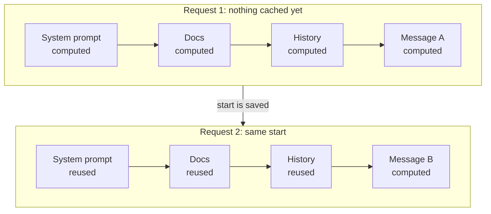
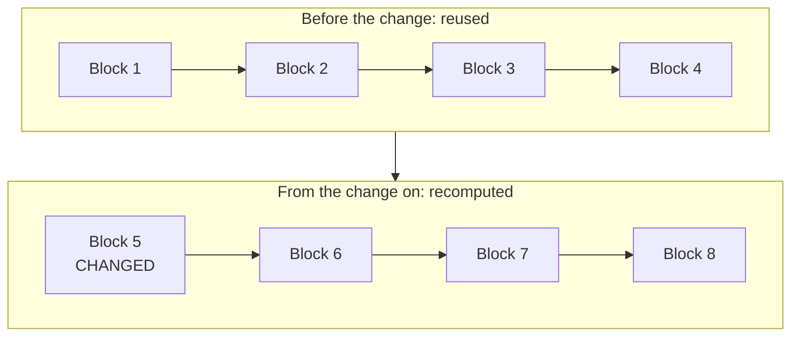
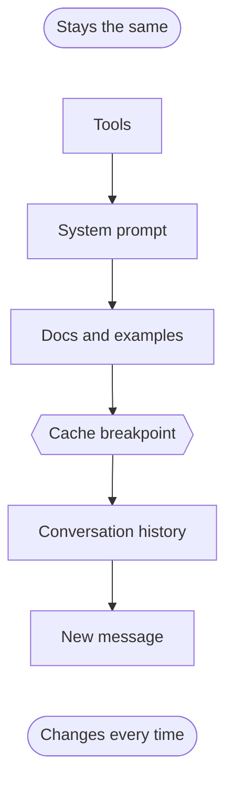

Every time you call an LLM API, you send the whole prompt again. The tool definitions, the system prompt, the conversation so far, and then the one new message at the end.

Most of that is the same as the last request. So a fair question is: does the model really read all of it from scratch every time?

With prompt caching, it doesn't have to. The provider keeps some of the work from your earlier request and reuses it. This post walks through what exactly gets kept, why it can be reused, and how to shape your prompts so the reuse actually happens.

## What prompt caching is

First, two terms.

A **token** is a small chunk of text. Models read your prompt as a list of tokens, not as words.

When a model reads those tokens, it calculates two things for each token in each layer: a **key (K)** and a **value (V)**. You can think of them as the model's notes about each token, which later tokens use to look back at earlier ones.

**Prompt caching** means the provider saves the K and V for the start of your prompt. That start is called the **prefix**. If your next request begins with exactly the same prefix, the model loads those saved values instead of calculating them again. ([OpenAI](https://developers.openai.com/api/docs/guides/prompt-caching))

OpenAI's docs are clear on this point: what's stored is the K/V tensors (multi-dimensional arrays of numbers), not your tokens. ([OpenAI](https://developers.openai.com/api/docs/guides/prompt-caching))

And yes, it's cheaper. Cached input tokens are billed lower than regular ones. On most Anthropic models, a cache read costs 0.1× the base input price. ([Anthropic](https://platform.claude.com/docs/en/build-with-claude/prompt-caching))

## What it is not

These are easy to mix up, so it helps to be specific.

**It doesn't store the answer.** The model still writes a fresh response every time. Send the same prompt twice and you can get two different answers, even when the usage data says tokens were cached. ([ngrok](https://ngrok.com/blog/prompt-caching), [OpenAI](https://developers.openai.com/api/docs/guides/prompt-caching))

**It's not semantic caching.** Semantic caching stores answers and looks them up by meaning, so "similar enough" questions can match. Prompt caching only works on an exact token match of the prefix. ([DigitalOcean](https://www.digitalocean.com/community/tutorials/prompt-caching-explained))

**It's not fine-tuning.** No model weights change. ([Hannecke](https://medium.com/@michael.hannecke/prompt-caching-explained-what-it-is-what-it-isnt-and-when-to-use-it-9f5c6fce7bdb))

**It's not permanent.** Every cache entry expires after a while. ([Anthropic](https://platform.claude.com/docs/en/build-with-claude/prompt-caching))

One more detail: temperature, top_p and top_k don't affect the cache. They only change the very last step, where the model picks the next token. ([ngrok](https://ngrok.com/blog/prompt-caching))

## How a model reads your prompt: prefill and decode

A model works in a loop. It reads the whole context, writes one token, adds that token to the context, and goes again. ([ngrok](https://ngrok.com/blog/prompt-caching))

That loop has two phases, and the difference matters here.

**Prefill** is the first pass. The model reads every token in your prompt and calculates K and V for each one, in every layer. This is what decides your **time to first token (TTFT)**, the wait before the first word of the answer shows up.

**Decode** comes after. The model writes the answer one token at a time. Each new token looks back at the K and V of everything before it.

Prompt caching shortens prefill. It doesn't speed up decode, so the answer still streams at the same pace. ([Hannecke](https://medium.com/@michael.hannecke/prompt-caching-explained-what-it-is-what-it-isnt-and-when-to-use-it-9f5c6fce7bdb))

## The KV cache, and what prompt caching adds to it

Inside a single request, the model already keeps the K and V of earlier tokens around, so it doesn't redo them for every new token it writes. That store is the **KV cache**. ([ngrok](https://ngrok.com/blog/prompt-caching))

That part is standard. Prompt caching takes one extra step: it keeps the prefix part of the KV cache *after the request ends*, so the next request can pick it up. ([vLLM](https://docs.vllm.ai/en/latest/design/prefix_caching.html))

Here's the idea in one picture. The first request computes everything. The second request starts the same way, so it reuses that start and only computes the new message.

## Why only the start can be reused

This is the key idea behind everything else in this post.

Models connect tokens using **attention**. Each token looks at the tokens before it. A **causal mask** stops it from looking at anything after it. ([ngrok](https://ngrok.com/blog/prompt-caching))

So the values for token 5 depend on tokens 1 to 5. Nothing after token 5 can affect them.

Each token also carries its position in the prompt. ([ngrok](https://ngrok.com/blog/prompt-caching))

Put those together and you get one simple rule. If you change token 5, the values for token 5 and everything after it change. Tokens 1 to 4 stay exactly the same. The provider can reuse 1 to 4, but it has to recompute everything from 5 on.

It also means the same paragraph sitting at a different position isn't reused. The position is different, and so is everything before it.

## Blocks, hashes and routing

So how does a provider actually find a matching prefix? The open-source inference engine vLLM documents one way to do it, and it's a good mental model. ([vLLM](https://docs.vllm.ai/en/latest/design/prefix_caching.html))

- The KV cache is split into **blocks**, each holding a fixed number of tokens.
- Each block gets a **hash** (a short fingerprint of the data). The hash is built from the previous block's hash plus this block's tokens.
- Because each hash includes the one before it, a block's hash really stands for every token up to that point. Two prompts share blocks only until the first block where they differ.
- Only full blocks get cached.
- When memory runs out, the least recently used blocks are removed first.

The big providers follow the same idea, each with their own rules:

- **Anthropic** writes one cache entry at each **cache breakpoint**, a marker you put on a content block. The entry is a hash of everything up to that block. On the next request, the system looks back up to 20 blocks for an entry an earlier request wrote. ([Anthropic](https://platform.claude.com/docs/en/build-with-claude/prompt-caching))
- **OpenAI** checks its breakpoints from the longest prefix down to the shortest. ([OpenAI](https://developers.openai.com/api/docs/guides/prompt-caching))
- **DeepSeek** stores "cache prefix units" on disk, and a hit needs a full match of one of them. ([DeepSeek](https://api-docs.deepseek.com/guides/kv_cache))

There's also a physical side to this. The cache lives on a specific machine. Your request only gets a hit if it lands on a machine that has your prefix. ([OpenAI](https://developers.openai.com/api/docs/guides/prompt-caching))

OpenAI routes requests based on machine load and a hash of the first tokens of your prompt. You can also pass a `prompt_cache_key` to influence that. If a single prefix gets more than roughly 15 requests per minute, some of them can spill over to other machines, and fewer get a hit. ([OpenAI](https://developers.openai.com/api/docs/guides/prompt-caching))

## How long a cache lives

**TTL** (time to live) is how long a cache entry stays available. Every hit resets it. ([OpenAI](https://developers.openai.com/api/docs/guides/prompt-caching), [Anthropic](https://platform.claude.com/docs/en/build-with-claude/prompt-caching))

A couple of details from Anthropic's docs are easy to miss. The TTL starts when the request *starts*, not when the response finishes, so a long answer eats into it. And a new entry is only usable once the first response has started, so parallel requests sent at the same moment won't hit each other's cache. ([Anthropic](https://platform.claude.com/docs/en/build-with-claude/prompt-caching))

**Eviction** is when the system removes an entry, because memory is limited. Vertex AI moves evicted prefixes into a "durable" storage tier instead of dropping them, and an implicit entry there lasts 24 hours at most. ([Vertex AI](https://docs.cloud.google.com/vertex-ai/generative-ai/docs/context-cache/context-cache-overview))

## How each provider does it

Same idea everywhere, different controls. Here's a compact view.

| | OpenAI | Anthropic | Gemini | Bedrock | DeepSeek |
|---|---|---|---|---|---|
| How you turn it on | Automatic. GPT-5.6+ also supports explicit breakpoints. | Add `cache_control`, at the top level or on blocks. Up to 4 breakpoints. | Implicit by default on 2.5+. Explicit cache objects on 2.5 and 3.x. | Implicit, explicit, or both, by model. Up to 4 checkpoints. | Automatic, stored on disk. |
| Minimum prompt size | 1,024 tokens (GPT-5.6+) | 512 to 4,096 tokens, by model | 2,048 or 4,096 tokens, by model | 512 to 4,096 tokens, by model | Not stated |
| TTL | At least 30 min (GPT-5.6+) | 5 min, or 1 h | Explicit caches: 1 h default, adjustable | 5 min on many models, 1 h on newer Claude, 30 min on OpenAI models | Hours to days |
| Usage fields | `cached_tokens`, `cache_write_tokens` | `cache_read_input_tokens`, `cache_creation_input_tokens` | cached token count in `usage_metadata` | `cacheReadInputTokens`, `cacheWriteInputTokens` | `prompt_cache_hit_tokens`, `prompt_cache_miss_tokens` |
| Docs | [link](https://developers.openai.com/api/docs/guides/prompt-caching) | [link](https://platform.claude.com/docs/en/build-with-claude/prompt-caching) | [link](https://ai.google.dev/gemini-api/docs/generate-content/caching) | [link](https://docs.aws.amazon.com/bedrock/latest/userguide/prompt-caching.html) | [link](https://api-docs.deepseek.com/guides/kv_cache) |

These numbers change often, so check the linked docs for your model.

## How to order your prompt

Once the "only the start is reused" rule sinks in, the advice becomes simple. Put what doesn't change first, and what does change last.

A good order looks like this:

1. Tool definitions
2. System prompt
3. Documents and examples
4. Conversation history
5. The new user message

Anthropic always builds the prefix as tools, then system, then messages. A change at one level wipes the cache for that level and everything after it. ([Anthropic](https://platform.claude.com/docs/en/build-with-claude/prompt-caching))

The Claude Code team describes the same layering in their own product: static system prompt and tools first, then CLAUDE.md, then session context, then the conversation. ([Claude Code post](https://claude.dev/blog/lessons-from-building-claude-code-prompt-caching-is-everything/))

## Dos and don'ts, straight from the providers

Everything below comes from what each source actually says. Nothing added.

### Anthropic

- Put cached content at the start of the prompt.
- Put the breakpoint on the last block that stays the same between requests.
- Don't put the breakpoint on a block that changes every time, like one with a timestamp. You'd write the cache on every request and never read it.
- Use more than one breakpoint if parts of the prompt change at different rates.
- Keep `tool_choice`, images and thinking settings the same between calls.
- Keep JSON key order stable in tool blocks. Some languages shuffle it.
- For parallel requests, wait for the first response to start before sending the rest.

Source: [Anthropic prompt caching docs](https://platform.claude.com/docs/en/build-with-claude/prompt-caching)

### The Claude Code team

- Static content first, dynamic content last.
- Send new information, like the current time, in the next message instead of editing the system prompt.
- Don't add or remove tools mid-session.
- Don't switch models mid-session. The new model has to build its own cache.
- Use a tool to switch modes (they do this for plan mode) instead of changing the tool set.
- When compacting a long conversation, reuse the exact same system prompt, tools and history as the main conversation.
- Watch your cache hit rate the way you'd watch uptime.

Source: [Lessons from building Claude Code](https://claude.dev/blog/lessons-from-building-claude-code-prompt-caching-is-everything/)

### OpenAI

- Put stable instructions and shared material first.
- Move timestamps and user-specific content to the end.
- Add new messages rather than rewriting earlier turns.
- Keep tool definitions, their order and their schemas stable.
- To turn tools off for a request, use `tool_choice` or `allowed_tools` instead of removing them.
- On GPT-5.6 and later, add an explicit breakpoint right after your stable content.
- On older models, use a stable `prompt_cache_key` for requests that share a prefix.

Source: [OpenAI prompt caching guide](https://developers.openai.com/api/docs/guides/prompt-caching)

### Google Gemini

- Put large, common content at the start of the prompt.
- Send requests with a similar prefix close together in time.
- Use explicit caching when you need guaranteed savings.
- On Vertex AI, keep cached data scoped to each user session.

Sources: [Gemini API caching](https://ai.google.dev/gemini-api/docs/generate-content/caching), [Vertex AI context caching](https://docs.cloud.google.com/vertex-ai/generative-ai/docs/context-cache/context-cache-overview)

### AWS Bedrock

- Static content first, dynamic content last.
- Place cache checkpoints after the stable content.
- Don't set `ttl` on models that only support the 5-minute cache.

Source: [Bedrock prompt caching](https://docs.aws.amazon.com/bedrock/latest/userguide/prompt-caching.html)

### DeepSeek

DeepSeek's docs don't list dos and don'ts. They describe caching as best-effort, with no guaranteed hits. ([DeepSeek](https://api-docs.deepseek.com/guides/kv_cache))

## How to check that it's working

You don't have to guess. Every provider reports cache activity in the `usage` part of the response.

- **OpenAI:** `usage.input_tokens_details.cached_tokens` and `cache_write_tokens`. ([OpenAI](https://developers.openai.com/api/docs/guides/prompt-caching))
- **Anthropic:** `cache_read_input_tokens`, `cache_creation_input_tokens` and `input_tokens`. Note that `input_tokens` here only counts tokens after the last breakpoint. If both cache fields are 0, nothing was cached. ([Anthropic](https://platform.claude.com/docs/en/build-with-claude/prompt-caching))
- **Gemini:** the cached token count in `usage_metadata`, or `cachedContentTokenCount` on Vertex AI. ([Gemini](https://ai.google.dev/gemini-api/docs/generate-content/caching), [Vertex AI](https://docs.cloud.google.com/vertex-ai/generative-ai/docs/context-cache/context-cache-overview))
- **Bedrock:** `cacheReadInputTokens` and `cacheWriteInputTokens`. ([Bedrock](https://docs.aws.amazon.com/bedrock/latest/userguide/prompt-caching.html))
- **DeepSeek:** `prompt_cache_hit_tokens` and `prompt_cache_miss_tokens`. ([DeepSeek](https://api-docs.deepseek.com/guides/kv_cache))

To get a hit rate, divide cached tokens by total input tokens. Grouping it by user, workspace or day makes drops easier to spot. ([OpenAI](https://developers.openai.com/api/docs/guides/prompt-caching))

If there's one thing to take away, it's the prefix rule. The model can only reuse what comes before the first change, so the way you order your prompt decides how much of the cache you actually get.

## Further reading

- [Prompt caching: 10x cheaper LLM tokens, but how?](https://ngrok.com/blog/prompt-caching) by Sam Rose (ngrok). Walks through attention step by step with interactive visuals.
- [Lessons from building Claude Code: Prompt caching is everything](https://claude.dev/blog/lessons-from-building-claude-code-prompt-caching-is-everything/) by Thariq Shihipar
- [Anthropic: Prompt caching](https://platform.claude.com/docs/en/build-with-claude/prompt-caching)
- [OpenAI: Prompt caching](https://developers.openai.com/api/docs/guides/prompt-caching)
- [Gemini API: Context caching](https://ai.google.dev/gemini-api/docs/generate-content/caching)
- [Vertex AI: Context caching overview](https://docs.cloud.google.com/vertex-ai/generative-ai/docs/context-cache/context-cache-overview)
- [AWS Bedrock: Prompt caching for faster model inference](https://docs.aws.amazon.com/bedrock/latest/userguide/prompt-caching.html)
- [DeepSeek: Context caching](https://api-docs.deepseek.com/guides/kv_cache)
- [vLLM: Automatic prefix caching](https://docs.vllm.ai/en/latest/design/prefix_caching.html)
- [DigitalOcean: Prompt caching explained](https://www.digitalocean.com/community/tutorials/prompt-caching-explained)
- [Prompt caching explained: what it is, what it isn't, and when to use it](https://medium.com/@michael.hannecke/prompt-caching-explained-what-it-is-what-it-isnt-and-when-to-use-it-9f5c6fce7bdb) by Michael Hannecke
